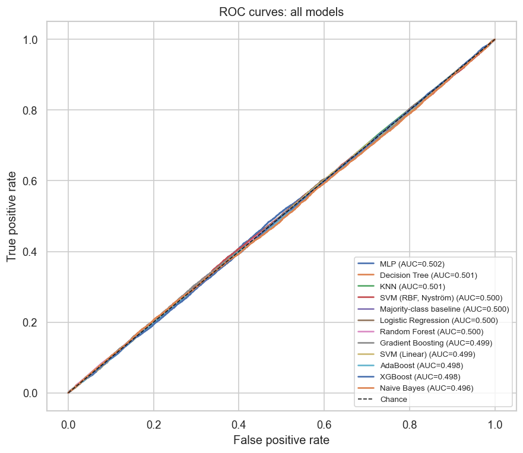
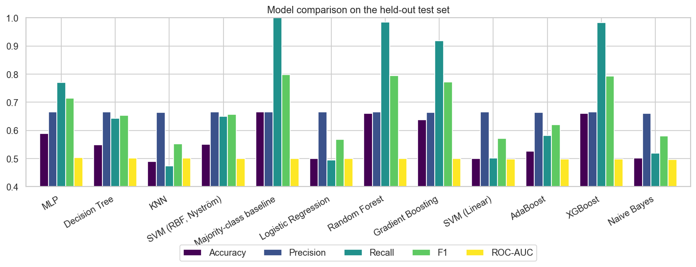
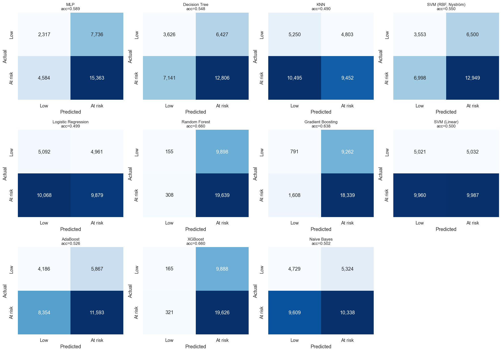
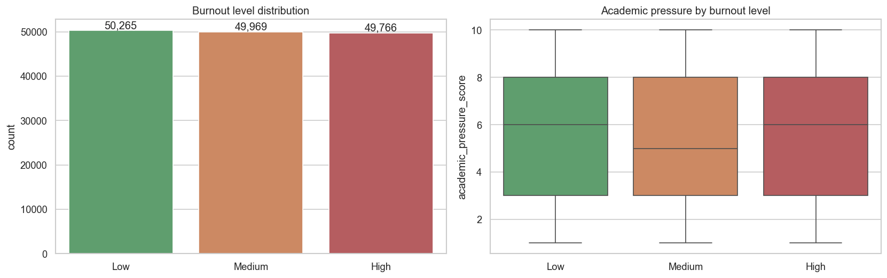
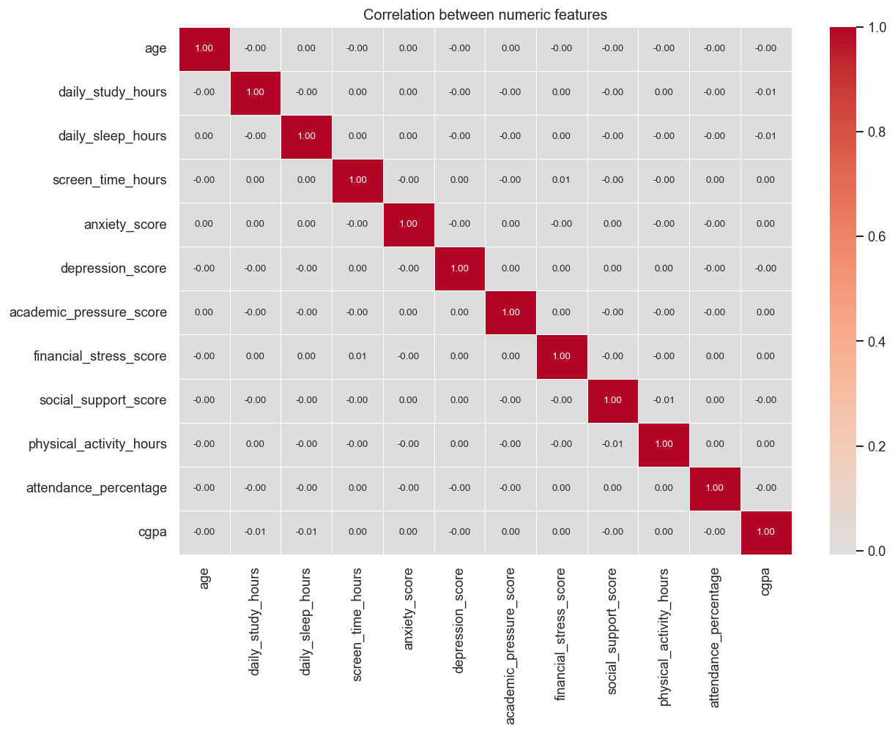
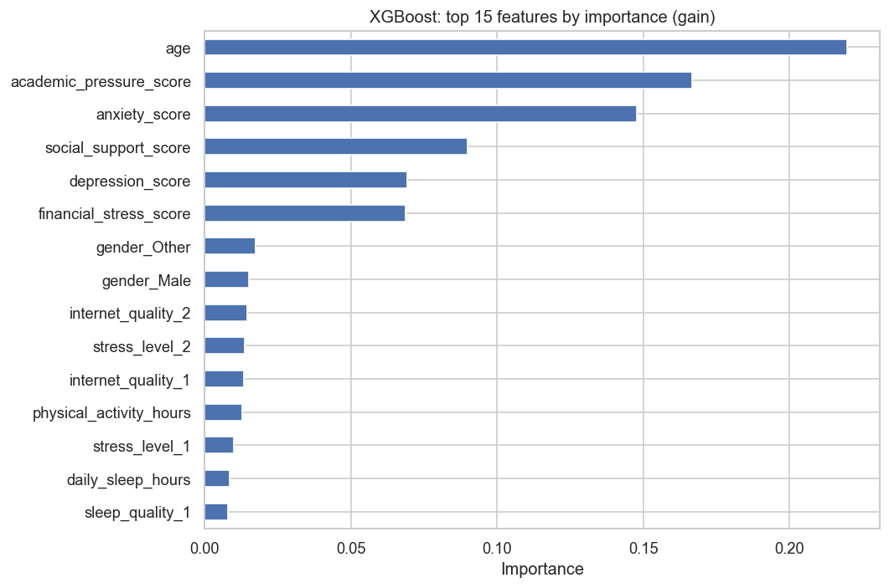

# 🎓 Student Burnout Prediction: When the Data Has No Signal


This project benchmarks **11 classifiers** on 150,000 student records (lifestyle, mental-health and academic features) to predict burnout risk. Its main result is a negative one, shown rigorously: **the features carry no information about the burnout label.** Every model performs at chance, and the best "accuracy" is exactly what you get by always predicting the majority class.

The notebook shows how to detect that, instead of reporting a misleading 66% accuracy.

<p align="center">
  
</p>

## 📊 Results

Held-out test set: 30,000 students (stratified 20%). The task is *Low* vs. *At-risk* (Medium + High) burnout, and 66.5% of students are at risk.

| Model | Accuracy | Precision | Recall | F1 | ROC-AUC |
|---|---:|---:|---:|---:|---:|
| **Majority-class baseline** | **0.665** | 0.665 | 1.000 | 0.799 | 0.500 |
| Random Forest | 0.660 | 0.665 | 0.985 | 0.794 | 0.500 |
| XGBoost | 0.660 | 0.665 | 0.984 | 0.794 | 0.498 |
| Gradient Boosting | 0.638 | 0.664 | 0.919 | 0.771 | 0.499 |
| MLP | 0.589 | 0.665 | 0.770 | 0.714 | 0.502 |
| SVM (RBF, Nyström) | 0.550 | 0.666 | 0.649 | 0.657 | 0.500 |
| Decision Tree | 0.548 | 0.666 | 0.642 | 0.654 | 0.501 |
| AdaBoost | 0.526 | 0.664 | 0.581 | 0.620 | 0.498 |
| Naive Bayes | 0.502 | 0.660 | 0.518 | 0.581 | 0.496 |
| SVM (Linear) | 0.500 | 0.665 | 0.501 | 0.571 | 0.499 |
| Logistic Regression | 0.499 | 0.666 | 0.495 | 0.568 | 0.500 |
| KNN | 0.490 | 0.663 | 0.474 | 0.553 | 0.501 |

## 🔍 How We Know There's No Signal

1. **Statistical tests before modelling.** Kruskal–Wallis tests (numeric features) and χ² tests (categorical features) were run against burnout level. **0 of 18 features** are significant at α = 0.05 with Bonferroni correction, even with n = 150,000, which is enough to detect very small effects.
2. **Identical class profiles.** Feature means for the Low, Medium and High groups differ by less than 0.1 units on every feature.
3. **Threshold-free metric.** All 11 models have **ROC-AUC between 0.496 and 0.502**, which is a coin flip.
4. **Precision equals the base rate.** Every model's precision is about 0.665, the share of at-risk students. Predictions carry no information beyond the prior.
5. **The "best" models are majority-class predictors.** Random Forest and XGBoost reach 66% accuracy only because they predict *at risk* for about 98% of students. Neither beats the trivial baseline.

**Takeaways**
- Always report a **trivial baseline** and a **threshold-free metric** such as ROC-AUC alongside accuracy.
- **SMOTE moves the decision threshold but can't create signal.** That's why linear models trained on balanced data fall to about 50% accuracy while trees drift back toward the majority class.
- The dataset is almost certainly **synthetic with randomly assigned labels**. A real study needs measured outcomes, for example scores from the Maslach Burnout Inventory.

## 🔬 Pipeline

```
150k records ─► EDA + signal tests ─► ordinal/one-hot encoding ─► 6 engineered features
             (mental-health index, lifestyle balance, academic stress index,
              support/stress ratio, performance score, sleep efficiency)
             ─► stratified 80/20 split ─► StandardScaler ─► SMOTE (train only)
             ─► 11 classifiers + majority baseline ─► accuracy · precision · recall · F1 · ROC-AUC
```

<details>
<summary><b>More figures</b></summary>







</details>

## 🚀 Run It

```bash
git clone https://github.com/nabilah-hossain-ruba/student-burnout-prediction.git
cd student-burnout-prediction
pip install -r requirements.txt
jupyter notebook student_burnout_prediction.ipynb
```

The full run takes about 11 minutes on a laptop CPU. The original Colab version used RAPIDS cuML for the SVMs; this version swaps in CPU equivalents (calibrated `LinearSVC`, and a Nyström-approximated RBF kernel) so it runs anywhere.

## 🗂️ Project Structure

```
├── student_burnout_prediction.ipynb   # EDA → signal tests → 11 models → evaluation
├── student_mental_health_burnout.csv  # Dataset (150,000 × 20)
├── results.csv                        # Metrics table
├── images/                            # Exported figures
├── docs/                              # Project report and literature review
├── original/colab_export.py           # Original Colab script (GPU / cuML)
└── requirements.txt
```

## 📚 References (Literature Review)

- *Academic Burnout Detection Using Behavioral Data Analysis*
- *Burnout Risk Profiles in Psychology Students: An Exploratory Study*
- *Detecting Burnout Among Undergraduate Computing Students with Supervised Machine Learning*
- *Modelling an Innovative Machine Learning Model for Student Stress Forecasting*
- *Predicting Burnout in College Students: A Machine Learning Approach Using Decision Tree and Psychometric Data*
- *Student Burnout: A Review on Factors Contributing to Burnout*
- *Time Series Analysis for Education: Methods, Applications, and Future Directions*

---

*Group 29 · course project for CSE437 at BRAC University.*
